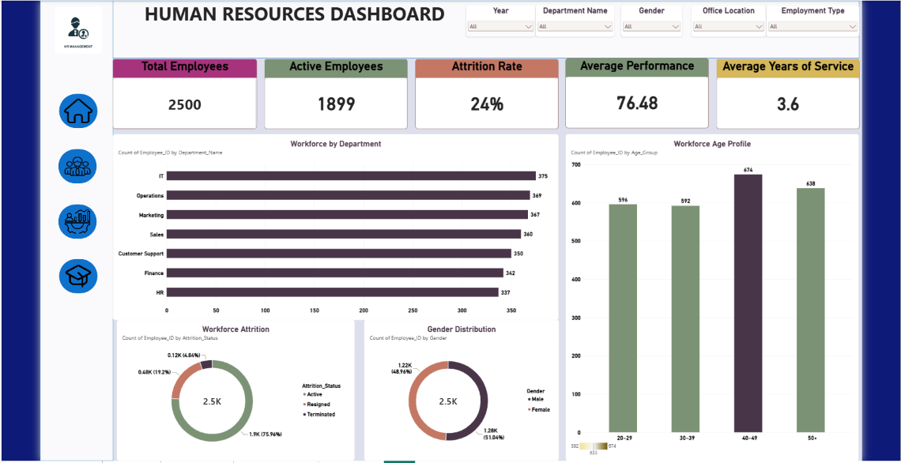
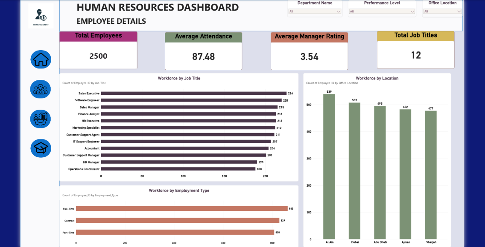
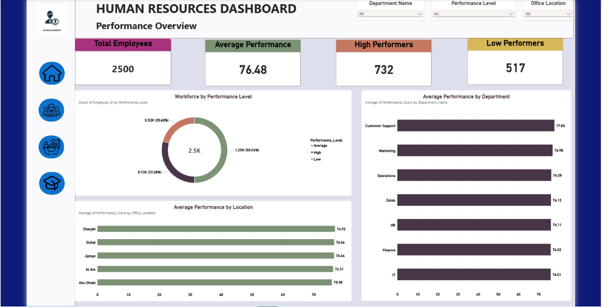
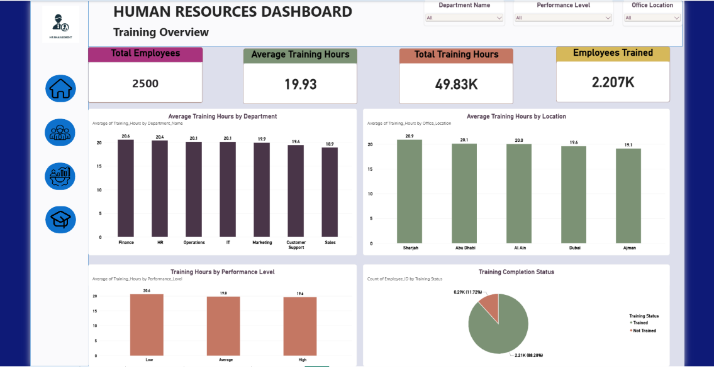

# HR Analytics & Workforce Performance Dashboard

An interactive HR Analytics dashboard developed using Microsoft Power BI to analyze workforce distribution, employee performance, attrition, attendance, and training outcomes.

## 📊 Project Overview

This project analyzes employee and workforce data to provide HR teams with a clear view of workforce composition, employee performance, attrition, attendance, and training.

The dashboard was designed to transform raw HR data into interactive KPIs and visual insights that can support workforce planning and HR decision-making.

## 🎯 Business Problem

HR teams need to understand:

- How the workforce is distributed across departments, locations, job roles, and employment types
- What proportion of employees are active or have left the organization
- How employee performance varies across departments and locations
- How training participation and training hours vary across the workforce
- Whether workforce demographics and employee-related metrics indicate areas that require attention

The objective of this project is to provide an interactive dashboard that allows HR stakeholders to explore these areas through KPIs, filters, and visual analysis.

## 🎯 Project Objectives

- Analyze overall workforce distribution
- Monitor employee attrition
- Evaluate employee performance
- Analyze workforce distribution by job title and location
- Compare employment types
- Analyze attendance and manager ratings
- Analyze employee training hours
- Evaluate training completion
- Identify meaningful workforce patterns and trends
- Provide actionable HR insights

## 🛠️ Tools & Technologies

- **Power BI**
- **Power Query**
- **DAX**
- **Microsoft Excel**
- Data Cleaning
- Data Transformation
- Data Validation
- Data Visualization
- KPI Development
- Business Analysis

## 📁 Dataset

The dataset contains employee-level HR information including:

- Employee ID
- Employee Name
- Department
- Location
- Job Title
- Salary Band
- Employment Type
- Gender
- Age Group
- Hire Date
- Attendance Rate
- Performance Score
- Performance Level
- Review Status
- Manager Rating
- Training Hours
- Attrition Status
- Exit Date
- Manager ID

## 🔄 Data Preparation

The data was prepared and validated before dashboard development.

Key preparation activities included:

- Reviewing data structure and field types
- Checking missing values
- Validating categorical fields
- Checking date fields
- Reviewing employee and department relationships
- Preparing fields for analysis
- Creating calculated measures in Power BI
- Building an interactive reporting model

## 📌 Key KPIs

The dashboard includes KPIs such as:

- Total Employees
- Active Employees
- Attrition Rate
- Average Performance
- Average Years of Service
- Average Attendance
- Average Manager Rating
- High Performers
- Low Performers
- Average Training Hours
- Total Training Hours
- Employees Trained

## 📊 Dashboard Pages

### 1. HR Dashboard Overview

Provides a high-level view of:

- Total and active employees
- Attrition rate
- Average performance
- Average years of service
- Workforce by department
- Workforce age profile
- Workforce attrition
- Gender distribution

### 2. Workforce Overview

Analyzes:

- Workforce by job title
- Workforce by location
- Workforce by employment type
- Average attendance
- Average manager rating
- Total job titles

### 3. Performance Overview

Analyzes:

- Workforce by performance level
- Average performance by department
- Average performance by location
- High performers
- Low performers

### 4. Training Overview

Analyzes:

- Average training hours by department
- Average training hours by location
- Training hours by performance level
- Training completion status
- Total training hours
- Employees trained

## 🔎 Key Insights

## 🔎 Key Business Insights

### Workforce Overview

- The organization has **2,500 employees**, with **1,899 active employees**.
- The overall **attrition rate is 24%**, indicating a significant level of employee turnover that should be monitored.
- IT has the largest workforce among the seven departments, with **375 employees**, while HR has **337 employees**.
- The workforce is distributed across five locations, with **Al Ain having the highest employee count (539)**.

### Performance Analysis

- The overall average employee performance score is **76.48**.
- **732 employees** are classified as high performers, while **517 employees** are classified as low performers.
- **Customer Support** has the highest average performance score at approximately **77.85**.
- Performance scores across departments are relatively close, ranging from approximately **76.01 to 77.85**.

### Training Analysis

- Total recorded training hours are **49,830**, with an average of **19.93 training hours per employee**.
- Approximately **2,207 employees (88.28%)** are recorded as trained.
- **293 employees (11.72%)** are recorded as not trained.
- Average training hours vary across departments, with Finance showing the highest average at approximately **20.6 hours**.

### HR Management Perspective

The dashboard highlights three areas that HR teams can monitor closely:

1. **Employee attrition** – identify departments and workforce segments requiring retention strategies.
2. **Performance development** – understand differences in performance across departments and locations.
3. **Training participation** – identify employees who have not completed training and evaluate the relationship between training and performance.
   
## 💡 Business Recommendations

Based on the dashboard analysis:

1. **Monitor attrition closely**  
   HR teams should investigate departments, locations, and employee groups with higher attrition.

2. **Support lower-performing employees**  
   Targeted training and performance improvement plans can help employees classified as low performers.

3. **Use high-performing employees as benchmarks**  
   HR teams can analyze practices and behaviours associated with high-performing employees.

4. **Evaluate training effectiveness**  
   Training participation should be compared with employee performance to understand whether training is contributing to improved outcomes.

5. **Support workforce planning**  
   Workforce distribution by department, location, job title, and employment type can help HR teams identify staffing requirements.

## 📷 Dashboard Preview

### HR Dashboard Overview

### Workforce Overview

### Performance Overview

### Training Overview

## 👩‍💻 Skills Demonstrated

This project demonstrates practical experience in:

- Data analysis
- Data cleaning
- Data validation
- Data transformation
- Power Query
- DAX
- Power BI dashboard development
- KPI reporting
- Data visualization
- Business interpretation
- HR analytics

## 📌 Project Outcome

The final dashboard converts employee-level HR data into an interactive reporting solution that enables users to filter and analyze workforce, performance, attrition, and training metrics from multiple perspectives.

---

**Project Type:** Data Analytics / Business Intelligence  
**Domain:** Human Resources  
**Primary Tool:** Microsoft Power BI
